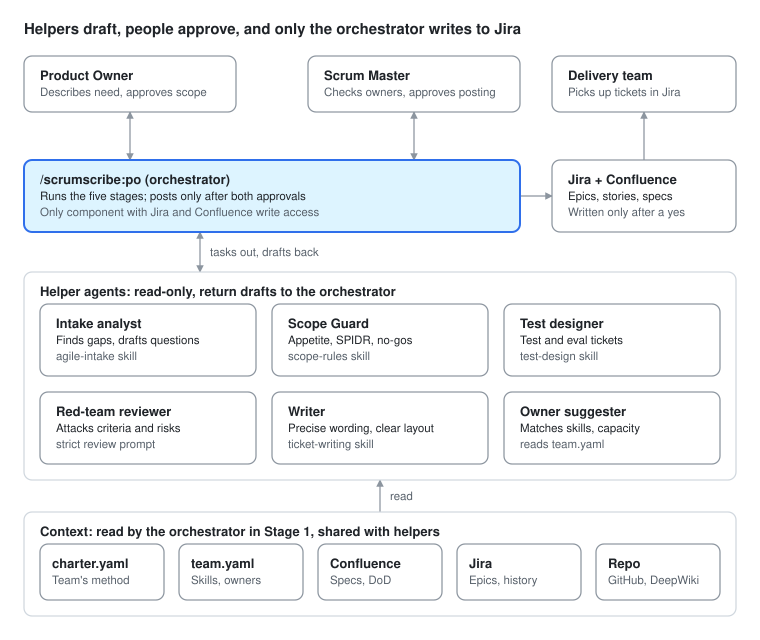
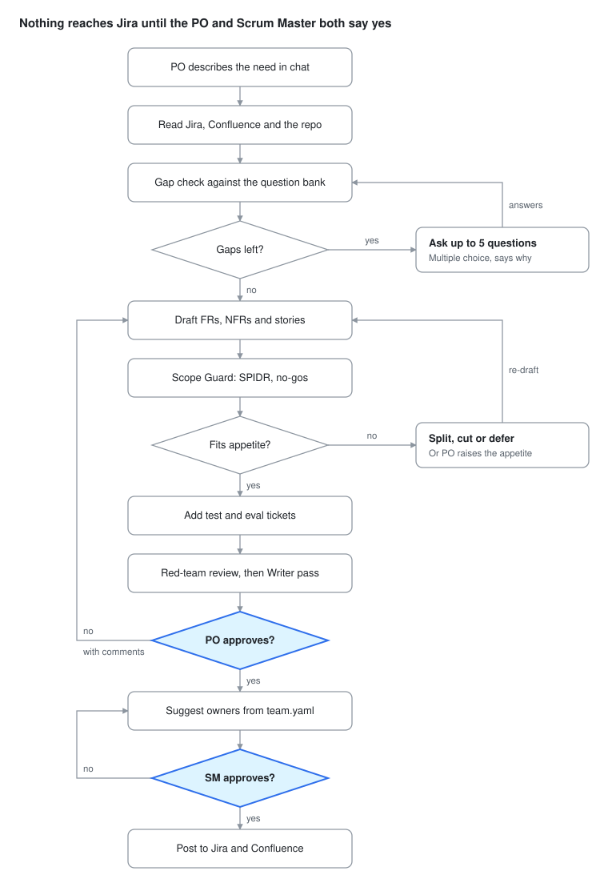

<div align="center">


# ScrumScribe

### Your PO talks. ScrumScribe writes the backlog, with approvals.

**A human-in-the-loop harness that turns a Product Owner conversation into scoped, testable Jira tickets.**

Helpers read and draft. People approve. Only the orchestrator writes, after both approvals.

[](LICENSE)
[](https://code.claude.com/docs/en/plugins)
[](#status-and-limitations)
[](https://github.com/shmouses/scrumscribe/actions/workflows/validate.yml)

[**Website**](https://shmouses.github.io/scrumscribe/) · [**Quickstart**](#quickstart) · [**Other agents**](#use-it-in-claude-code-cursor-codex-and-other-agents) · [**Worked example**](examples/walkthrough.md) · [**Recommend a harness**](https://github.com/shmouses/scrumscribe/issues/new?template=harness_recommendation.yml)

</div>

---

## Why

Product Owners know the problem. Engineers know the system. Tickets sit in the gap between them, and that gap is where scope creeps, acceptance criteria go vague, and tests get bolted on at the end.

ScrumScribe sits in that gap. A PO who is not technical can describe what they need in plain English. The harness reads what already exists in Jira, Confluence and the repo, asks only for what is missing, drafts lean stories with testable criteria, and hands a clean package to the Scrum Master (or whichever role your team names). The orchestrator posts nothing until both approvals are recorded, and a hook asks a human before any Atlassian tool that can change data.

## How the pieces connect

<p align="center"></p>

## The workflow

<details>
<summary><b>Show the end-to-end flowchart</b></summary>
<p align="center"></p>
</details>

| Stage | What happens | Output |
|---|---|---|
| 1. Discover | Reads Jira, Confluence and the repo. Every fact gets a source link. | `context.md` |
| 2. Gap check | Marks each question-bank area Known, Inferred or Missing. | `gaps.md` |
| 3. Ask | Asks the PO at most five questions per round, multiple choice where possible. | `answers.md` |
| 4. Draft | Requirements, lean stories, test and eval tickets, red-team review, house-style rewrite. | `draft/`, `reviews.md` |
| 5. Hand off | PO approval, owner suggestions from `team.yaml`, second approval (Scrum Master by default), then posting. | `approvals.md`, `posted.md` |

## Quickstart

**You need:** [Claude Code](https://code.claude.com/docs/en/overview), opened in your project's folder. For reading and posting, an Atlassian MCP connection to Jira Cloud and Confluence Cloud ([Atlassian's setup guide](https://support.atlassian.com/atlassian-ai-gateway/docs/get-started-with-the-atlassian-remote-mcp-server/)).

```text
# 1. Add this marketplace and install the plugin (inside Claude Code)
/plugin marketplace add shmouses/scrumscribe
/plugin install scrumscribe@scrumscribe

# 2. Connect Jira and Confluence, then sign in when prompted (or via /mcp)
/plugin install atlassian@claude-plugins-official
/reload-plugins

# 3. Tailor it to your team (writes .scrumscribe/charter.yaml and .scrumscribe/team.yaml)
/scrumscribe:setup we run two-week Scrum, epics and stories, we want a PRD and ADRs

# 4. Start a session
/scrumscribe:po Finance wants to export invoices without asking engineering
```

Without the Atlassian connection, ScrumScribe still runs: it drafts everything into `.scrumscribe/work/` and you paste the tickets yourself.

> **Tip:** add `.scrumscribe/work/` to your project's `.gitignore`. Session work holds internal Jira and Confluence content. The charter and team file can be committed if your team wants.

## Use it in Claude Code, Cursor, Codex and other agents

ScrumScribe is built as a Claude Code plugin, but its skills use the open [Agent Skills](https://agentskills.io) format: a folder with a `SKILL.md` file. Many coding agents load that format, so the core workflow travels. Some parts don't, and the table says which.

| | Claude Code | Cursor | Codex, Gemini CLI, GitHub Copilot and others |
|---|---|---|---|
| Skills (`po`, `setup` and the four method skills) | Yes | Yes | Yes |
| Read-only helper agents | Yes | Yes, copy the agent files | Usually no. The orchestrator plays each helper in turn ("single-agent mode") |
| Approval hook | Yes | No. Keep Cursor's approval prompt on for Atlassian MCP tools | No. Use the tool's own "ask before running tools" mode |
| Jira and Confluence | Atlassian MCP | Atlassian MCP in Cursor's MCP settings | The tool's MCP settings |
| Start a session | `/scrumscribe:po` | `/po` in Agent chat | The tool's skill picker (for example `$po` in Codex) |

The same two files, `.scrumscribe/charter.yaml` and `.scrumscribe/team.yaml`, drive every tool. So do the five stages and the two approvals.

### Claude Code (full support)

Follow the [Quickstart](#quickstart).

### Cursor

Run this in your project folder:

```bash
git clone https://github.com/shmouses/scrumscribe.git /tmp/scrumscribe
mkdir -p .cursor/skills .cursor/agents
cp -r /tmp/scrumscribe/plugins/scrumscribe/skills/* .cursor/skills/
cp /tmp/scrumscribe/plugins/scrumscribe/agents/*.md .cursor/agents/
```

Then:
1. Add the Atlassian MCP server in Cursor's MCP settings.
2. In Agent chat, run `/setup`, then `/po <what you need>`.
3. Keep tool approval on for Atlassian tools. Without the Claude Code hook, that prompt is your safety gate.

Cursor's subagents can't load skills directly. The helper files tell them to read the skill's `SKILL.md` instead. If `po` or `setup` clash with skills you already have, rename those two folders.

### Codex

```bash
git clone https://github.com/shmouses/scrumscribe.git /tmp/scrumscribe
mkdir -p .agents/skills
cp -r /tmp/scrumscribe/plugins/scrumscribe/skills/* .agents/skills/
```

Codex reads `.agents/skills` in your repo, or `~/.agents/skills` for every project. Start with `/skills` or by typing `$po`. Codex's own subagents use a different file format, so ScrumScribe runs in single-agent mode: the orchestrator follows `skills/po/helpers/` one helper at a time. Use an approval mode that asks before running tools.

### Gemini CLI, GitHub Copilot and other Agent Skills tools

The [skills CLI](https://github.com/vercel-labs/skills) detects the coding agents on your machine and copies skills into each one's folder:

```bash
npx skills add shmouses/scrumscribe
```

Or copy `plugins/scrumscribe/skills/*` into the folder your tool reads skills from. These tools run ScrumScribe in single-agent mode.

> **Tested so far:** the full plugin in Claude Code (validator and hook tests), and a copied install's file layout for Cursor and Codex. Live sessions in Cursor, Codex and the other tools haven't been tested yet. If you try one, please [open an issue](https://github.com/shmouses/scrumscribe/issues/new?template=bug_report.yml) with what worked.

## What's inside

| Component | Type | What it does |
|---|---|---|
| `/scrumscribe:po` | Skill (you run it) | The orchestrator. Runs the five stages and holds the only write access. |
| `/scrumscribe:setup` | Skill (you run it) | Builds the team charter and team file from an interview, existing Confluence pages, or a plain-English description. |
| `agile-intake` | Skill | Known / Inferred / Missing method, question bank, FR and NFR formats, document catalogue. |
| `scope-rules` | Skill | Appetite first, SPIDR splitting, rabbit holes and no-gos, size limits. |
| `test-design` | Skill | When to create integration, eval or UAT tickets, and what they must contain. |
| `ticket-writing` | Skill | House style: precise wording and a scannable layout. |
| `intake-analyst`, `scope-guard`, `test-designer`, `red-team-reviewer`, `writer`, `owner-suggester` | Subagents | Read-only helpers. They have no write tools at all. |
| Approval hook | Hook | Asks a human before any Atlassian MCP tool that is not a known read (get, list, search, lookup, fetch). |
| `skills/setup/templates/`, `skills/po/templates/` | Files | Charter, team file, ticket templates (story, spike, NFR, test, eval) and the handoff template. Kept inside skill folders so they travel to other agents. |
| `skills/po/helpers/` | Files | Copies of the helper instructions, for tools that can't run subagents. CI keeps them identical to `agents/`. |

## Tailor it to any organization

Two small files, owned by the team, decide how the harness behaves:

```yaml
# .scrumscribe/charter.yaml (excerpt)
method: scrum                 # scrum | kanban | shape-up | custom
sprint_length_days: 10
hierarchy: [epic, story, subtask]
docs_wanted: [prd, fr-nfr-spec, adr, test-plan]
limits: { stories_per_epic: 8, acceptance_criteria_per_story: 5 }
approvals: { second_approver_role: scrum-master }   # PO approval is always on
```

```yaml
# .scrumscribe/team.yaml (excerpt): minimal work data only
pods:
  - name: Billing
    owns: [billing-api]
    members:
      - name: person-a          # a name or handle
        skills: { backend: 3, data: 2 }
        accountable_for: [billing-api]
        capacity_pct: 80
```

Or skip the YAML and tell it: *"We run Kanban, no sprints, we want ADRs and a test plan, and the QA lead approves instead of a Scrum Master."* Setup shows the resulting charter and saves it only after you say yes.

## Safety model

Some guarantees are enforced by how the parts are wired. Others are rules the orchestrator follows. The difference matters, so here it is plainly.

**Enforced by wiring**
- **Helpers cannot write.** Their tool lists are `Read`, `Grep`, `Glob` (and `Skill` where needed). No MCP tools, no shell. CI checks this on every push.
- **A hook asks before Atlassian changes.** Any Atlassian MCP tool that is not a known read (`get`, `list`, `search`, `lookup`, `query`, `fetch`, `executeRead`) triggers a confirmation prompt. It fails closed: an unknown new tool asks.

**Followed by the orchestrator**
- **Two approvals.** The PO approves scope; the second approver (Scrum Master by default) approves owners and posting. Both are recorded in `approvals.md`.
- **Suggest, never assign.** Owner suggestions come from `team.yaml`; the second approver decides.
- **Everything is auditable.** Each session leaves a plain-text trail in `.scrumscribe/work/<epic>/`.

**Data**
- Credentials live in Claude Code's connections, never in the repo or the YAML.
- `team.yaml` holds minimal work data: a name or handle, skills, ownership, capacity. No contact details, ratings or health.

## Status and limitations

This is a **v0.2 preview**. Be aware of what that means:

- The plugin passes `claude plugin validate`, and the approval hook was tested against sample Atlassian tool names. It has **not yet been run on a real team's backlog**. Feedback from real use is the next milestone.
- Posting needs **Jira Cloud and Confluence Cloud** through the official Atlassian connection. Jira Data Center is untested.
- Atlassian tool names can change. The hook fails closed (unknown tools ask), but check the matcher in `plugins/scrumscribe/hooks/hooks.json` after Atlassian updates.
- The hook covers Atlassian **MCP** tools only. It does not cover direct REST calls through a shell. Its behaviour in bypass-permissions mode is untested.
- Outside Claude Code (Cursor, Codex and others) the approval hook doesn't apply, and in single-agent mode one agent plays every helper. The tool's own approval prompts are then the only enforced gate.
- Approvals are recorded in the conversation. The harness does not verify who is typing; whoever approves is asked to give their name or role.
- The quality of the questions depends on what Discover can read. Thin Confluence spaces mean more questions.

## Roadmap

- [ ] Pilot with a real product team and publish the lessons
- [ ] Optional GitHub Issues and Linear targets alongside Jira
- [ ] Charter presets for Kanban, Shape Up and scaled setups
- [ ] Evaluation set for ticket quality (clarity, scope, testability)
- [ ] Notion and Google Docs as document targets

## Credits and inspiration

ScrumScribe builds on published methods and community work. It does not bundle or copy their code; install them separately if you want them.

| Source | What we borrowed |
|---|---|
| [*Shape Up*](https://basecamp.com/shapeup) (Basecamp) | Appetite, rabbit holes, no-gos |
| [SPIDR](https://www.mountaingoatsoftware.com/blog/five-simple-but-powerful-ways-to-split-user-stories) (Mike Cohn) | Story-splitting prompts |
| [Scrum Guide 2020](https://scrumguides.org/scrum-guide.html) | Product Goal, Sprint Goal, Definition of Done |
| [ISO/IEC 25010:2023](https://www.iso.org/standard/78176.html) | Quality characteristics checklist for NFRs |
| [Ponytail](https://github.com/DietrichGebert/ponytail) | The "lazy senior" principle, applied to tickets in Scope Guard |
| [Thermos](https://github.com/cursor/plugins) ("thermo-nuclear" review, a Cursor plugin) | The idea of a strict review step for high-risk tickets |
| [ASD-STE100 skills](https://skills.sh/danyuchn/asd-ste100-skill/asd-ste100), [SimpleEnglish](https://github.com/AminBlg/SimpleEnglish) | Precision-writing principles |
| [i-have-adhd](https://github.com/ayghri/i-have-adhd) | Answer-first, scannable layout principles |
| [BMAD Method](https://github.com/bmad-code-org/BMAD-METHOD) and its Test Architect module | Agile agent roles; recommended test strategy companion |
| [Atlassian MCP server](https://github.com/atlassian/atlassian-mcp-server) and its spec-to-backlog skill | The idea of showing the breakdown before creating anything |
| [agent-po](https://github.com/nandiewg-crypto/agent-po) | Sub-agents prepare, the orchestrator publishes |

Not affiliated with or endorsed by any of the above, by Atlassian, or by Anthropic. ASD-STE100 is a standard of ASD; this project is not certified by ASD.

## Contributing

Ideas, bug reports and pull requests are welcome. See [CONTRIBUTING.md](CONTRIBUTING.md).

**Know a harness that does this better, or part of it?** [Open a recommendation](https://github.com/shmouses/scrumscribe/issues/new?template=harness_recommendation.yml). Comparing notes is half the point of publishing this.

## License

[MIT](LICENSE) © 2026 Shayan Mousavi M.
